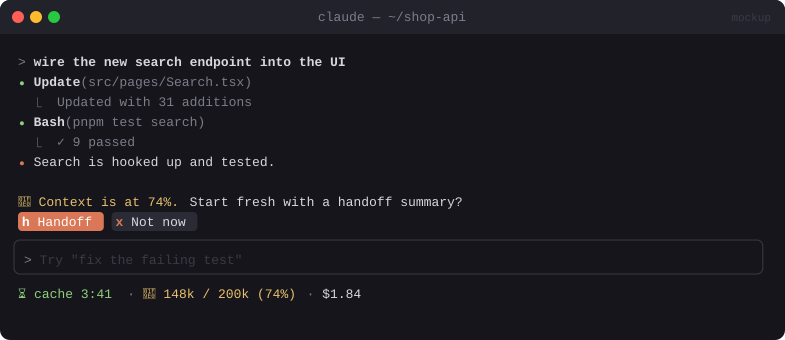

# ⏳ Cachekeeper

> A status strip with the cache countdown and context size, plus a one-click Session Handoff: summarise, clear, carry on.


<sub>Mockup: an illustration of the idea. Your build may look different.</sub>

[← All mods](../../README.md)

| | |
|---|---|
| **Category** | Cost & Context |
| **Surfaces** | Status line · band above prompt · slash command |
| **Difficulty** | 🟡 Medium |
| **Source** | [nateherkai/claude-code-mods](https://github.com/nateherkai/claude-code-mods) |

## Ready-made version

The published **Cache Keeper** does all of this and more: a cold-send guard, `/keepwarm`, a `/board` of every local chat, and a `/handoff` that runs a bundled skill. Read the code before installing.

```bash
claude plugin marketplace add nateherkai/claude-code-mods
claude plugin install cache-keeper@nateherk-mods
```

Open a new chat afterwards: the mod loads when a chat starts.

## What it does

- **Status strip:** `⏳ cache 3:41 · 🧠 112k / 200k (56%) · $1.84`. It turns amber at 70% context and red at 85%.
- **Session Handoff** (`/handoff` or the band's button, shown once context passes 70%):
  1. Writes a structured summary (goal, decisions, files touched, open TODOs, next step) to `.claude/handoffs/<timestamp>.md`.
  2. Clears the conversation.
  3. Starts the fresh session with the summary pre-filled in the prompt, so you can check it before sending.

## Build prompt

```text
Use the plugin-authoring skill to build a Claude Code mod named "cachekeeper".

Requirements:
1. Every second ($.clock.every), update the status line with: cache time left (TTL from
   userConfig, default 5 min, counted from the last model request), context used/limit and %
   from $.session.usage(), and session cost. Colour it amber at 70%, red at 85%.
2. When context passes 70%, show a band above the prompt: "Context 72% — [Handoff] [Later]".
3. "/handoff" (and the Handoff button): call $.model.fork asking for a handoff note in
   Markdown with the sections Goal, Decisions, Files touched, Open TODOs, Next step. Save it
   with $.fs.write to .claude/handoffs/<ISO-timestamp>.md under the project root.
4. Then clear the conversation (run /clear via $.command.run) and put "Continue from this
   handoff:\n\n<summary>" in the prompt bar with $.prompt.fill. Don't auto-send.
5. "/handoff list" shows the saved handoffs. Pressing one fills the prompt with it.

Write a test for the threshold logic and the handoff file path and run
`claude plugin validate`.
```

## Under the hood

| Need | Mod API |
|---|---|
| Live numbers | `$.session.usage()` → `context.percent`, `cost` |
| Summary from the cached transcript | `$.model.fork` (cheap: served from the prompt cache) |
| Clear and carry over | `$.command.run`, `$.prompt.fill`, `$.fs.write` |

## Try it

Set the threshold to 10% in config, chat a little, and press **Handoff** when the band appears.

## Gotchas

- `/compact` is the built-in alternative. A handoff gives you a file you can keep, read and edit, and a clean slate.
- Add `.claude/handoffs/` to `.gitignore` if you don't want them committed.
