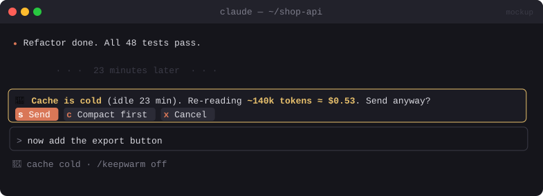

# 💸 Cash Tax

> Warns you before a prompt hits a cold cache and makes Claude re-read the whole conversation at full price. Includes `/keepwarm`.


<sub>Mockup: an illustration of the idea. Your build may look different.</sub>

[← All mods](../../README.md)

| | |
|---|---|
| **Category** | Cost & Context |
| **Surfaces** | Band above prompt (confirm) · status line · slash command |
| **Difficulty** | 🟡 Medium |

## What it does

- Tracks when the conversation last hit the API. Past the cache TTL (5 minutes by default, 1 hour on some setups, configurable), the next prompt pays to write the whole context to the cache again.
- **Intercepts that prompt** and shows: *"Cache is cold (idle 23 min). Re-reading ~140k tokens ≈ $0.53. Send anyway?"* with `[Send]` `[Compact first]` `[Cancel]`.
- Below a threshold (say under 20k tokens or under $0.05) it lets the prompt through without asking.
- `/keepwarm on|off`: while you're away, pings the cache just before it expires with the smallest call that keeps it warm. It stops after a limit you set (default 30 minutes) so it can't run up a bill overnight.

## Build prompt

```text
Use the plugin-authoring skill to build a Claude Code mod named "cash-tax".

Requirements:
1. Track the time of the last model request (turn.step / turn.complete) in $.state. Make the
   cache TTL a userConfig option (default 5 minutes; allow 60).
2. Hook prompt.submit. If the cache is cold, read the context size from $.session.usage() and
   estimate the cost of re-writing it at the current model's cache-write price (keep a small
   price table in the mod, also in userConfig). If above the threshold (default $0.05), hold
   the prompt and show a band: "Cache cold (idle X min) · ~N tokens · ≈ $Y" with buttons
   [Send anyway] [Compact first] [Cancel]. Send resubmits the same text, Compact runs
   /compact then submits, Cancel puts the text back in the prompt bar ($.prompt.fill).
3. Status line: "🔥 warm 3:12 left" / "🧊 cold", updated every second with $.clock.every.
4. "/keepwarm on|off [minutes]": while on and the session is idle, ~30 s before the TTL runs
   out, call $.model.fork with a one-word prompt and maxTokens 1 so the cached prefix is read
   (refreshing it) without adding anything to the conversation. Stop after the limit
   (default 30 min) and show a toast with how much the pings cost (from usage).
5. Never block a prompt if anything fails: fall back to letting it through.

Write a test for the cold/warm decision and the cost estimate and run `claude plugin validate`.
```

## Under the hood

| Need | Mod API |
|---|---|
| Hold a prompt | `prompt.submit` (drop it, then resubmit with `$.prompt.submit`) |
| Context size and cost | `$.session.usage()` → `context`, `cost` |
| Keep cache warm | `$.model.fork({ prompt })`: same prefix, served from cache, no rows added |
| Countdown | `$.clock.every` + `$.ui.status` |

## Try it

1. Have a long conversation, wait past the TTL (or set it to 1 minute in config), then type a prompt.
2. `/keepwarm on 10`, wait, and watch the status line stay 🔥.

## Gotchas

- Every keep-warm ping is billed as a cache read (cheap, but not free). It's only worth it for big contexts you'll come back to soon.
- Prices change. Keep the table in `userConfig`, not hard-coded in logic.
- Overlaps with [Cachekeeper](cachekeeper.md). Build one or the other, or merge them.
