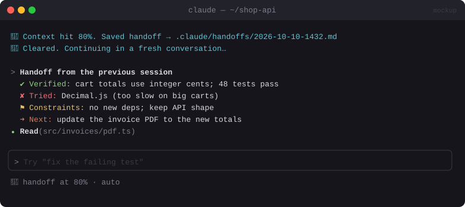

# 🔁 Context Handoff

> When the context window fills up, writes a handoff note, clears, and carries on in a fresh conversation automatically.


<sub>Mockup: an illustration of the idea. Your build may look different.</sub>

[← All mods](../../README.md)

| | |
|---|---|
| **Category** | Cost & Context |
| **Surfaces** | Band above prompt · session start |
| **Difficulty** | 🟡 Medium |

## What it does

- After each turn, checks context %. At the threshold (default 80%) it asks Claude for a structured handoff: **verified work, failed attempts, constraints, next step**.
- Saves it, runs `/clear`, and **auto-submits** the handoff as the first prompt of the fresh conversation, so the work keeps going without you.
- After a `/clear` or resume, tells Claude where the last session stopped.
- Also turns instructions you keep repeating into project notes.

> Compared with [Cachekeeper](cachekeeper.md): Cachekeeper asks you first and lets you review. Context Handoff is hands-off.

## Build prompt

```text
Use the plugin-authoring skill to build a Claude Code mod named "context-handoff".

Requirements:
1. On turn.complete, read context percent from $.session.usage(). At the threshold
   (userConfig, default 80) and only when idle, ask $.model.fork for a handoff in Markdown with
   sections: Verified work, Failed attempts (and why), Constraints, Next step.
2. Save it in $.store keyed by project root (keep the last 5), show a band line
   "🔁 Handing off at 81%…", then run /clear via $.command.run.
3. Submit "Continue from this handoff:\n\n<handoff>" with $.prompt.submit.
4. On classic.SessionStart with source "clear" or "resume", if a recent handoff exists and
   wasn't just used, add a short note telling Claude where the last session stopped.
5. "/handoff now" forces one; "/handoff off" disables it for this session.

Write a test for the threshold trigger and the saved handoff and run `claude plugin validate`.
```
