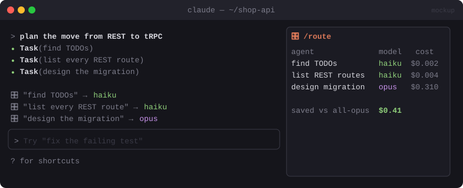

# 🎛️ Switchboard

> Picks a model for each subagent that doesn't name one (small, medium or large) and shows what every subagent cost.


<sub>Mockup: an illustration of the idea. Your build may look different.</sub>

[← All mods](../../README.md)

| | |
|---|---|
| **Category** | Cost & Context |
| **Surfaces** | Tool-call rewrite · band above prompt · pane · slash command |
| **Difficulty** | 🟡 Medium |

## What it does

- When Claude spawns a subagent without a `model`, it classifies the short label (*"grep for usages"* → small, *"design the migration"* → large) and rewrites the call to that model.
- One line per spawn above the prompt: `🎛️ "find TODOs" → haiku`.
- `/route` opens a pane listing every subagent, the model picked and what it cost.

## Build prompt

```text
Use the plugin-authoring skill to build a Claude Code mod named "switchboard".

Requirements:
1. Hook tool.call for the Agent/Task tool. If the input names no model, send ONLY the
   subagent type and its short description to a classifier that answers small | medium |
   large, and map those to models in userConfig (e.g. haiku / sonnet / opus).
2. userConfig "picker": off (just track cost) | jev | llm (a $.model.classify call with
   those three labels). userConfig "mode": auto (rewrite the model) | suggest (only show).
3. Rewrite the call's model with next({ ...e, input: { ...e.input, model } }) in auto mode.
   Fail open: if the classifier errors or times out (2 s), pass the call through unchanged.
4. Show one band line per spawn: label → model. Record each subagent's cost from its
   result/usage in $.state.
5. "/route" opens a pane with a table: label, picked model, cost, duration, plus totals.

Write tests for the mapping, the fail-open path and suggest mode and run
`claude plugin validate`.
```
