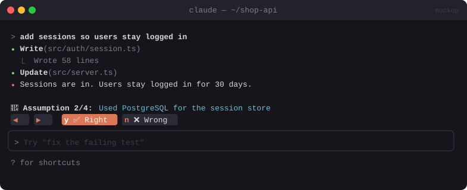

# 🤔 Assumption Checker

> After a vague task, lists the assumptions Claude made. You mark each ✅ Right or ❌ Wrong, and Wrong sends a fix-up prompt.


<sub>Mockup: an illustration of the idea. Your build may look different.</sub>

[← All mods](../../README.md)

| | |
|---|---|
| **Category** | Feedback & Learning |
| **Surfaces** | Band above prompt |
| **Difficulty** | 🟡 Medium |

## What it does

- At the end of a turn that made changes, asks a cheap side question: *"What assumptions did you make that the user didn't specify?"*
- Shows them one at a time in a band:
  `Assumption 2/4: Used PostgreSQL for the session store`  `[◀] [▶]  [✅ Right] [❌ Wrong]`
- **Wrong** opens a small field (*"what should it be?"*, optional), then sends Claude a follow-up: *"You assumed X. That's wrong: <your note>. Please fix it."*
- When all are marked, the band says *"All good ✓"* and fades out.

## Build prompt

```text
Use the plugin-authoring skill to build a Claude Code mod named "assumption-checker".

Requirements:
1. On turn.complete, only if the turn used Edit/Write/Bash, call $.model.fork (it shares the
   session's prompt cache, so it's cheap) asking: "List the assumptions you made in your last
   turn that the user did not explicitly specify. JSON array of short strings, max 5, [] if
   none." Parse defensively.
2. If there are any, draw a band above the prompt showing one assumption at a time with
   "i/N", prev/next buttons (hotkeys h/l) and [Right] (hotkey y) / [Wrong] (hotkey n).
3. Wrong → show an Input "What should it be? (optional)"; on submit, queue a follow-up with
   $.prompt.submit: "You assumed: <assumption>. That's wrong. <note>. Please fix only that."
4. Right → mark it and move on. When all are marked, show "All good ✓" for 3 s, then hide.
5. userConfig: "minEdits" (default 1) and "enabled". Add "/assumptions" to re-show the last set.

Write a test with a fake fork reply of 3 assumptions (Right, Wrong, Right) and run
`claude plugin validate`.
```

## Under the hood

| Need | Mod API |
|---|---|
| Ask Claude about its own turn, cheaply | `$.model.fork({ prompt })`: same transcript, served from cache, no rows added |
| Cycle + mark | `AbovePrompt` band, `Button` hotkeys, `Input` |
| Fix-up | `$.prompt.submit` (queues a new turn once idle) |

## Try it

Ask something deliberately vague, like *"add a login page"*.

## Gotchas

- Keep it quiet on small turns. Five assumptions after a one-line fix is noise.
- An alternative is a `prompt.compose` section asking Claude to write an `Assumptions:` list itself, which skips the extra call. It's cheaper, but it clutters every reply.
