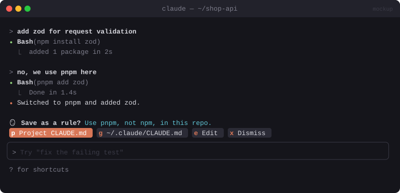

# 🪞 Reflect

> When you correct Claude ("no, that's wrong"), offers to save the lesson as a permanent rule in your `CLAUDE.md`.


<sub>Mockup: an illustration of the idea. Your build may look different.</sub>

[← All mods](../../README.md)

| | |
|---|---|
| **Category** | Feedback & Learning |
| **Surfaces** | Band above prompt · slash command |
| **Difficulty** | 🟢 Easy |

## What it does

- Spots corrective prompts: *"no"*, *"that's wrong"*, *"don't do X"*, *"I told you…"*, *"why did you…"*, *"stop …"*, *"use Y instead"*.
- Shows a band: *"Save this as a rule?"* with a one-line rule it drafted, e.g.
  `- Use pnpm, not npm, in this repo.`
  `[Save to project CLAUDE.md]` `[Save to ~/.claude/CLAUDE.md]` `[Edit]` `[Dismiss]`
- On save, appends the rule under a `## Learned rules` heading, skipping duplicates.

## Build prompt

```text
Use the plugin-authoring skill to build a Claude Code mod named "reflect".

Requirements:
1. Hook prompt.submit (let the prompt through unchanged). Detect corrections with a cheap
   regex pass ("no,", "that's wrong", "don't", "stop", "I told you", "instead", "why did
   you", "not what I"). If the regex is unsure, confirm with $.model.classify(text,
   ["correction", "other"]).
2. On a correction, call $.model.complete with a small fast model to turn the prompt (and the
   last assistant message, for context) into ONE short, general, imperative rule. Return
   nothing if it's a one-off and not a reusable rule.
3. Show a band above the prompt: the drafted rule plus buttons [Save to project]
   [Save to global] [Edit] [Dismiss]. Edit swaps in an Input prefilled with the rule.
4. Save: append "- <rule>" under "## Learned rules" in <project root>/CLAUDE.md or
   ~/.claude/CLAUDE.md (create the heading if missing; skip if a near-identical line exists).
   Show a toast "Saved to CLAUDE.md".
5. Rate limit: at most one suggestion every 3 prompts, and never for prompts under 3 words.

Write tests for detection (10 corrections, 10 normal prompts) and the append/dedupe step and
run `claude plugin validate`.
```

## Under the hood

| Need | Mod API |
|---|---|
| Watch prompts | `prompt.submit` → `next(e)` |
| Classify + draft | `$.model.classify`, `$.model.complete` |
| Band + edit field | `AbovePrompt`, `Button`, `Input` |
| Write rule | `$.fs.read` / `$.fs.write` |

## Try it

Ask Claude to install a package. When it uses npm, reply *"no, we use pnpm here"*.

## Gotchas

- Claude Code has its own memory as well. Reflect is for rules you want **in the repo**, in plain view and shared with your team.
- Prune `## Learned rules` now and then. A bloated CLAUDE.md costs tokens on every turn.
