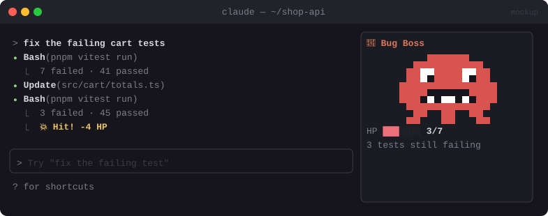

# 👾 Boss Fight

> Failing tests summon a pixel boss with one HP per failure. Every run that fixes tests lands a hit.


<sub>Mockup: an illustration of the idea. Your build may look different.</sub>

[← All mods](../../README.md)

| | |
|---|---|
| **Category** | Fun & Ambient |
| **Surfaces** | Pane with a pixel `Raster` · toast |
| **Difficulty** | 🟡 Medium |

## What it does

- Reads test runs (jest, vitest, pytest, go test) from Bash results.
- `7 failing` → a boss with 7 HP appears in a pane, with an HP bar.
- The next run with fewer failures plays a hit animation. At 0 failures you get a 🏆 victory toast.
- Falls back to a text HP bar where pixel drawing isn't available (Desktop).

## Build prompt

```text
Use the plugin-authoring skill to build a Claude Code mod named "boss-fight".

Requirements:
1. Hook tool.call for Bash and, after the result, parse test summaries (jest/vitest
   "Tests: X failed", pytest "N failed", go test "FAIL") into a failure count.
2. When failures > 0, open a pane titled "Boss" with a 32×16 pixel boss drawn as one Raster
   and an HP bar = current failures / starting failures.
3. On a run with fewer failures, play a short hit animation with $.ui.blit (flash + shake,
   ~6 frames). More failures → boss heals.
4. At 0, show a victory frame and a "🏆 Boss defeated in N runs" toast, then close after 5 s.
5. On surfaces without Raster, draw a text HP bar instead.

Write a test for the summary parsers and run `claude plugin validate`.
```
