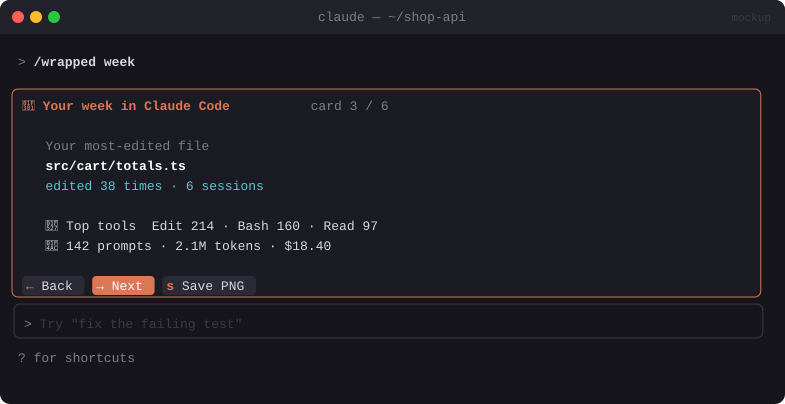

# 🎁 Session Wrapped

> `/wrapped`: a "Spotify Wrapped" style recap of your session (and week, and month) with a PNG card you can share.


<sub>Mockup: an illustration of the idea. Your build may look different.</sub>

[← All mods](../../README.md)

| | |
|---|---|
| **Category** | Fun & Ambient |
| **Surfaces** | Pane (stepped cards) · image export · slash command |
| **Difficulty** | 🟡 Medium |
| **Source** | [OneWave-AI/claude-code-mods](https://github.com/OneWave-AI/claude-code-mods/tree/main/session-wrapped) |

## Ready-made version

```bash
claude plugin marketplace add OneWave-AI/claude-code-mods
claude plugin install session-wrapped@claude-code-mods
```

> ⚠️ Same marketplace name clash as [Boss Fight](boss-fight.md): OneWave and hamzafer both use `claude-code-mods`.

## What it does

- `/wrapped` steps through 4–6 animated cards: prompts sent, tools used (top 3), files edited, tokens and cost, longest turn, and "your most-edited file".
- `/wrapped week` and `/wrapped month` total up your local transcripts under `~/.claude`.
- Exports a PNG card to disk. Everything stays local, with no network.

## Build prompt

```text
Use the plugin-authoring skill to build a Claude Code mod named "session-wrapped".

Requirements:
1. Gather stats for this session from $.session.messages() and $.session.usage(): prompts,
   tool calls by tool, distinct files edited, tokens, cost, longest turn.
2. "/wrapped week|month": read the transcript JSONL files under ~/.claude/projects with
   $.fs.list/$.fs.read and total the same stats for the period (skip unreadable lines).
3. Open a focused pane that steps through 4–6 big-number "cards" (Next/Prev, hotkeys
   l/h), with a simple fade between cards.
4. "Export" renders the summary card to a PNG (draw into an RGBA buffer and encode, or use a
   local tool via $.process.run) saved to ~/Downloads/claude-wrapped-<date>.png.
5. No network calls; nothing leaves the machine.

Write a test for the stats aggregation over a sample transcript and run
`claude plugin validate`.
```
