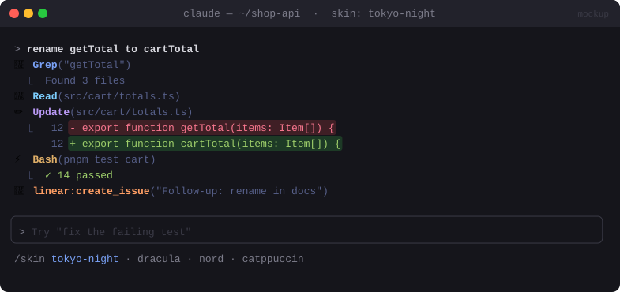

# 🎨 Claude Skins

> Change the look of Claude Code: an icon for each tool, colours for edits and code, and themes you can swap.


<sub>Mockup: an illustration of the idea. Your build may look different.</sub>

[← All mods](../../README.md)

| | |
|---|---|
| **Category** | Look & Feel |
| **Surfaces** | Transcript rows (tool calls, code blocks, edits) · slash command |
| **Difficulty** | 🟡 Medium |

## What it does

- Gives every tool call its own icon, so you can tell `Bash`, `Edit`, `Read`, `Grep` and MCP calls apart at a glance.
- Colours file edits (added and removed lines) and code blocks from a theme palette.
- Ships a **Tokyo Night** default and a `/skin <name>` command to switch themes. Each theme is one small palette object, so adding your own takes a minute.

## Build prompt

```text
Use the plugin-authoring skill to build a Claude Code mod named "claude-skins".

Requirements:
1. Hook ui.render on the tool-call rows of the transcript and draw each one with its own
   icon and accent colour per tool (Bash ⚡, Read 📖, Edit ✏️, Write 📝, Grep/Glob 🔍,
   WebFetch 🌐, Agent 🤖, any mcp__* tool 🔌). Fall back to the engine's own row for
   anything I didn't map.
2. Draw file edits as coloured diffs (Code with format "diff") and code blocks with the
   theme's syntax colours.
3. Keep every colour in one palette object per theme. Ship "tokyo-night" (default),
   "catppuccin-mocha" and "light". Adding a theme should mean adding one object.
4. Add a /skin command: no argument lists the themes, "/skin <name>" switches. Keep the
   choice in $.store so it survives restarts, and redraw at once.
5. While a row is expanded (ctrl+o), return the engine's own row so nothing is hidden.

Write a test that renders a tool row on both the terminal and desktop surfaces and run
`claude plugin validate`.
```

## Under the hood

| Need | Mod API |
|---|---|
| Restyle tool rows | `ui.render` hook on the tool-use component, return a tree or `next({ ...e, props })` |
| Diff colouring | `Code` element with `format: "diff"` |
| Theme switch | `$.command.register` + `command.run`; choice in `$.store`, live value in `$.state` |

## Try it

1. Ask Claude to read a file, grep for something and edit a line. Each row should have its own icon.
2. `/skin catppuccin-mocha`: the rows redraw straight away.
3. Restart Claude Code. The theme you picked should still be active.

## Gotchas

- A mod can only restyle the parts of the screen it hooks. The prompt box and the engine's own chrome keep their look.
- If a tree doesn't validate (wrong prop, element the surface lacks), the engine draws its own row and logs `ui.render (...) refused`. Run with `claude --debug` while you tune it.
