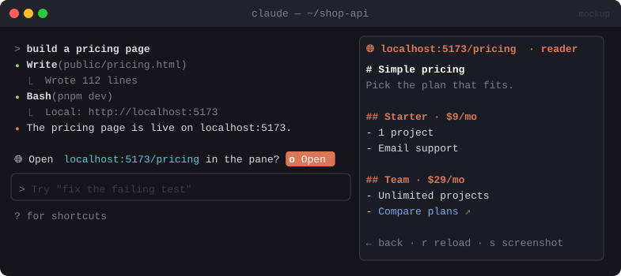

# 🌐 Terminal Browser

> Preview localhost pages, built HTML and GitHub PRs in a pane next to the chat, without switching windows.


<sub>Mockup: an illustration of the idea. Your build may look different.</sub>

[← All mods](../../README.md)

| | |
|---|---|
| **Category** | Look & Feel |
| **Surfaces** | Pane · slash command · clickable links |
| **Difficulty** | 🔴 Hard |

## What it does

- Opens a **browser pane** beside the transcript.
- Detects `http://localhost:*` URLs, `.html` files Claude just wrote and GitHub PR links, and offers to open them in the pane.
- Two render modes:
  - **Reader**: fetch the page and show it as Markdown (headings, lists, links, code). Works in any terminal.
  - **Screenshot**: capture the page with headless Chrome and show it as an image. Needs a terminal with the kitty graphics protocol (kitty, Ghostty). Elsewhere it falls back to Reader.
- Links in the pane are clickable and open inside the pane.

## Build prompt

```text
Use the plugin-authoring skill to build a Claude Code mod named "terminal-browser".

Requirements:
1. Add "/browse <url-or-path>" which opens a pane titled "Browser" beside the chat.
2. Reader mode (default): fetch the URL with $.http.fetch (or read a local .html file with
   $.fs.read), convert the HTML to Markdown and draw it with the Markdown element. Make links
   pressable (onLinkPress) so clicking one loads it in the same pane. Keep a back stack and
   show [Back] [Reload] [Screenshot] buttons at the top.
3. Screenshot mode: run headless Chrome via $.process.run
   (--headless --screenshot --window-size matching the pane) and draw the PNG with the Image
   element. If the terminal can't show images, fall back to Reader mode and say so.
4. Watch tool results and Claude's replies for localhost URLs, newly written .html files and
   github.com/.../pull/N links. When one shows up, show a toast offering "/browse <it>".
   Don't open the pane by itself.
5. For GitHub PR links, prefer `gh pr view <n> --json title,body,files` + `gh pr diff` and
   draw the diff with Code format "diff" instead of scraping HTML.

Write a test for the URL detection and the HTML→Markdown step and run `claude plugin validate`.
```

## Under the hood

| Need | Mod API |
|---|---|
| Side pane | `$.ui.open({ id, title })` + `ui.render` on `Pane` |
| Page content | `$.http.fetch`, `$.fs.read`, `Markdown` with `onLinkPress` |
| Screenshot | `$.process.run` (headless Chrome) + `Image` element (kitty graphics) |
| PR view | `$.process.run(["gh", ...])` + `Code format="diff"` |

## Try it

1. `npx serve .` (or any dev server), then `/browse http://localhost:3000`.
2. Ask Claude to write `hello.html`. A toast should offer to open it.
3. `/browse https://github.com/<owner>/<repo>/pull/1`.

## Gotchas

- It isn't a real browser engine: no JavaScript runs in Reader mode. Screenshot mode runs JS, but the result is a picture you can't interact with.
- A pane opened without you asking only docks as a sidebar on wide terminals (≈144 columns). Open it with `/browse` on narrower screens.
