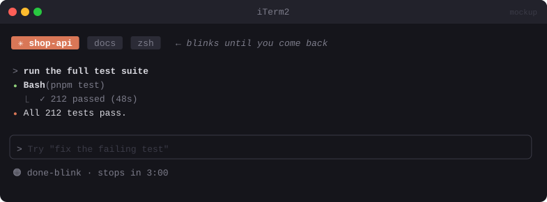

# 🟠 Done Blink

> When a turn finishes, the terminal tab blinks orange until you come back, so you can spot finished sessions among many tabs.


<sub>Mockup: an illustration of the idea. Your build may look different.</sub>

[← All mods](../../README.md)

| | |
|---|---|
| **Category** | Multi-Session |
| **Surfaces** | Terminal escape sequences · slash command |
| **Difficulty** | 🟢 Easy |

## What it does

- On turn complete, toggles the tab colour every 500 ms (iTerm2 escape codes, routed to the tmux client when inside tmux).
- Stops when you submit a prompt, or after a timeout (default 3 min).
- `/done-blink 60` sets the timeout.

## Build prompt

```text
Use the plugin-authoring skill to build a Claude Code mod named "done-blink".

Requirements:
1. On turn.complete (main conversation only), start a 500 ms $.clock.every that alternates
   the tab colour between orange and default using iTerm2's tab-colour escape sequences.
   Inside tmux, write to the client tty (tmux display -p '#{client_tty}' via $.process.run).
2. Stop on prompt.submit, or after the timeout (default 180 s), and reset the colour.
3. "/done-blink <seconds>" sets the timeout ($.store); "/done-blink off" disables it.
4. Fall back to a single $.ui.notify when the terminal isn't iTerm2.

Write a test for start/stop with the mocked clock and run `claude plugin validate`.
```
