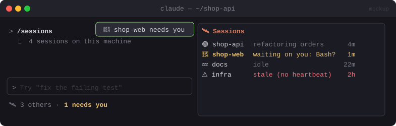

# 🛰️ Global Session Manager

> See every Claude Code session on your machine from any terminal: who's working, who's idle, and who's waiting on you.


<sub>Mockup: an illustration of the idea. Your build may look different.</sub>

[← All mods](../../README.md)

| | |
|---|---|
| **Category** | Multi-Session |
| **Surfaces** | Status line · pane · slash command · toast |
| **Difficulty** | 🔴 Hard |

## Ready-made (partial)

**Cache Keeper** (nateherkai/claude-code-mods) includes a `/board` pane listing every local chat (waiting first, then working, then cooling), with context, cost and cache state. Read the code before installing.

```bash
claude plugin marketplace add nateherkai/claude-code-mods
claude plugin install cache-keeper@nateherk-mods
```

## What it does

- Each session writes a small **heartbeat** file: project, status, current task, last activity, waiting-for-permission flag.
- The status line in every session shows a summary: `🛰️ 3 others · 1 needs you`.
- `/sessions` opens a pane: one row per session with folder, state (🟢 working / 💤 idle / 🔔 waiting on you / ⚠️ stale), what it's doing and for how long.
- A toast when another session starts **waiting on you**.

## Build prompt

```text
Use the plugin-authoring skill to build a Claude Code mod named "global-session-manager".

Requirements:
1. Heartbeat: on session.start and every 5 s ($.clock.every), write
   ~/.claude/mod-data/sessions/<session-id>.json with {id, pid, root, title, status,
   currentTask, lastTool, updatedAt}. status = working (turn running), idle, or waiting
   (a permission prompt or question is open). Delete the file on session.end.
2. Derive currentTask from the first line of the latest prompt; lastTool from tool.call.
3. Every 5 s, read the folder, ignore our own file, and mark entries stale if updatedAt is
   older than 30 s. Status line: "🛰️ N others · M need you".
4. "/sessions" opens a pane titled "Sessions": one row per session with folder, state icon,
   currentTask, and time in state. Sort waiting first.
5. When another session flips to waiting, show a toast "🔔 <folder> needs you" (once per flip).

Write a test with three fake heartbeat files (working, waiting, stale) and run
`claude plugin validate`.
```

## Under the hood

| Need | Mod API |
|---|---|
| Shared registry | `$.fs.write` / `$.fs.list` under `~/.claude/mod-data/` |
| Session facts | `$.session.id()`, `$.session.root()`, `turn.start` / `turn.complete` |
| Live summary | `$.clock.every`, `$.ui.status`, `$.ui.toast` |

## Gotchas

- Heartbeat files are plain text on disk. Keep them free of prompt content you wouldn't want other local processes to read: titles only, no secrets.
- Build this and [Same Folder Tracker](same-folder-tracker.md) on the **same** heartbeat format, so one mod's data feeds the other.
