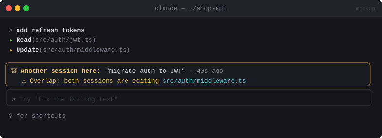

# 👯 Same Folder Tracker

> If another Claude session is working in the same folder, shows a banner with what it's doing and which files it's touching.


<sub>Mockup: an illustration of the idea. Your build may look different.</sub>

[← All mods](../../README.md)

| | |
|---|---|
| **Category** | Multi-Session |
| **Surfaces** | Band above prompt · toast |
| **Difficulty** | 🟡 Medium |

## What it does

- Detects other live Claude Code sessions in the **same project root**.
- Shows a banner while there are any:
  `👯 Another session here: "migrate auth to JWT" · editing src/auth/*.ts, middleware.ts · 40s ago`
- Highlights **overlap**: when this session reads or edits a file the other one touched recently, the banner turns amber and names the file.
- Updates live, so you don't give both sessions the same file.

## Build prompt

```text
Use the plugin-authoring skill to build a Claude Code mod named "same-folder-tracker".

Requirements:
1. Share the heartbeat registry with global-session-manager: every 3 s write
   ~/.claude/mod-data/sessions/<session-id>.json with {id, root, currentTask, recentFiles
   (last 20 paths edited/written with timestamps), updatedAt}.
2. Every 3 s, read the registry and keep entries with the same root (resolved real path),
   not us, and updated in the last 30 s.
3. If any, draw a band above the prompt: other session's task, the files it touched recently
   (collapse into globs when > 3), and "updated Xs ago".
4. Overlap: on tool.call for Read/Edit/Write, if the path is in another session's
   recentFiles from the last 10 min, make the band amber, name the file, and show a toast once.
5. Remove our file on session.end. Treat missing or bad files as "no other session".

Write a test with two fake sessions (same root and a different root) and run
`claude plugin validate`.
```

## Under the hood

| Need | Mod API |
|---|---|
| Registry | `$.fs.write`, `$.fs.list`, `$.fs.read`, `$.fs.stat({ resolve: true })` |
| Overlap | `tool.call` on file tools |
| Banner | `AbovePrompt` band, `$.ui.toast` |

## Gotchas

- Pairs naturally with [Collision Guard](../safety/collision-guard.md): this one warns, that one blocks.
