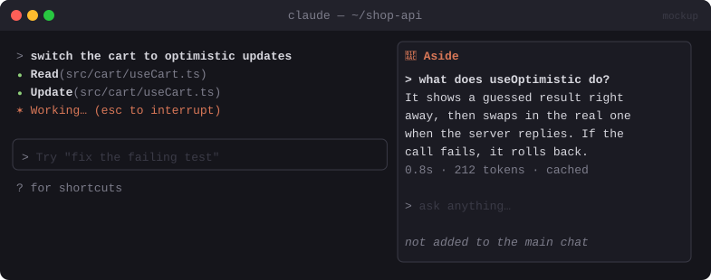

# 💬 Aside

> `/aside` opens a side chat next to the transcript for quick questions. It shares the session's cache, and the main thread never sees it.


<sub>Mockup: an illustration of the idea. Your build may look different.</sub>

[← All mods](../../README.md)

| | |
|---|---|
| **Category** | Prompting & Flow |
| **Surfaces** | Pane with input · slash command |
| **Difficulty** | 🟢 Easy |
| **Source** | [JayDoubleu/aside](https://github.com/JayDoubleu/aside) |

## Ready-made version

```bash
claude plugin marketplace add JayDoubleu/aside
claude plugin install aside@aside
```

## What it does

- `/aside` works **mid-turn**. It opens a docked pane with a text field.
- Ask *"wait, what does `useOptimistic` do?"* or *"why did you pick that approach?"*. A tool-less fork of the conversation answers it, served from the prompt cache, so it's fast and cheap.
- **Nothing is written back** to the main conversation, so Claude's working context stays clean.
- Shows latency and tokens per answer. The history lasts for the session only.

## Build prompt

```text
Use the plugin-authoring skill to build a Claude Code mod named "aside".

Requirements:
1. Register "/aside" with immediate: true so it works while a turn runs. It opens a pane
   titled "Aside" with an Input, a scrollable Q&A list (Markdown), and [Clear] [Close].
2. On submit, call $.model.fork({ prompt: question }): a tool-less question over the
   session's own transcript. Show the answer as Markdown, plus latency and
   usage.cache_read_input_tokens / output tokens.
3. Never append anything to the main conversation.
4. Handle "nothing-to-fork" (a brand-new session) with a friendly message.
5. Keep Q&A history in $.state for the session only.

Write a test with a mocked fork result and run `claude plugin validate`.
```
