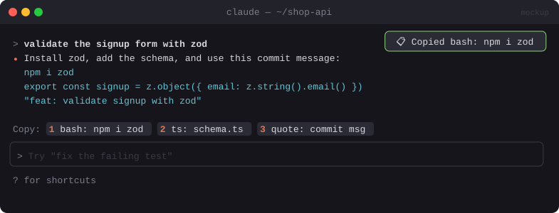

# 📋 Copy Band

> One-press copy buttons above the prompt for every code block in Claude's last answer, with a stash of older ones.


<sub>Mockup: an illustration of the idea. Your build may look different.</sub>

[← All mods](../../README.md)

| | |
|---|---|
| **Category** | Prompting & Flow |
| **Surfaces** | Band above prompt · toast |
| **Difficulty** | 🟢 Easy |
| **Source** | [yash-gadodia/claude-mods](https://github.com/yash-gadodia/claude-mods/tree/main/copy-band) |

## Ready-made version

```bash
claude plugin marketplace add yash-gadodia/claude-mods
claude plugin install copy-band@claude-mods
```

## What it does

- After each answer: `Copy: [1 bash: npm i zod] [2 ts: schema.ts] [3 quote: commit msg]`
- Press `1`–`9` (or click) to copy. A toast confirms. No model turn is used.
- The last N blocks are stashed, so you can still copy something from three answers ago.

## Build prompt

```text
Use the plugin-authoring skill to build a Claude Code mod named "copy-band".

Requirements:
1. On turn.complete, extract fenced code blocks and blockquotes from the last assistant
   message (via $.session.messages()).
2. Draw a band above the prompt: one Button per block with hotkeys 1–9 and a short label
   (language + first ~20 chars).
3. Pressing copies with $.ui.copy({ text, surface: e.surface }) and shows a "copied" toast.
4. Keep the last 20 blocks in $.store; "/copies" opens a pane listing them with copy buttons.
5. Hide the band when I start typing.

Write a test for block extraction (nested fences, quotes) and run `claude plugin validate`.
```
