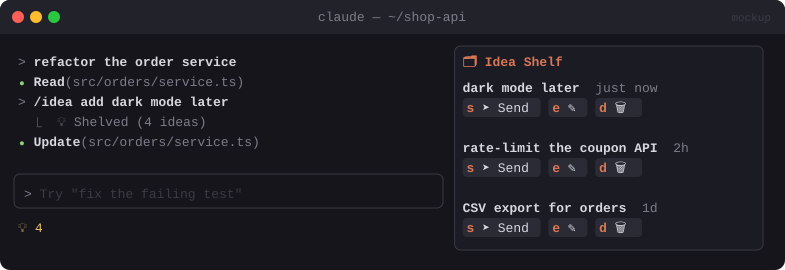

# 🗂️ Idea Shelf

> `/idea <thought>` saves stray ideas to a shelf for each project without interrupting Claude. Send one when you're ready.


<sub>Mockup: an illustration of the idea. Your build may look different.</sub>

[← All mods](../../README.md)

| | |
|---|---|
| **Category** | Prompting & Flow |
| **Surfaces** | Pane · slash command · status line |
| **Difficulty** | 🟢 Easy |

## What it does

- `/idea add dark mode later` saves the note instantly, **even mid-turn**, without reaching Claude.
- `/ideas` opens the **Shelf** pane: each idea with its age and `[➤ Send]` `[✎]` `[🗑]`.
- **Send** puts the idea in the prompt bar as a task and removes it from the shelf.
- Ideas are kept per project directory and survive restarts. The status line shows `💡 4`.
- Optional: mirror to `IDEAS.md` in the repo.

## Build prompt

```text
Use the plugin-authoring skill to build a Claude Code mod named "idea-shelf".

Requirements:
1. Register "/idea <text>" with immediate: true so it works while a turn is running. It saves
   {id, text, createdAt} to $.store under a key derived from $.session.root(), answers with
   a short "💡 saved" row, and adds nothing to Claude's context.
2. "/ideas" opens a pane titled "Idea Shelf": newest first, each row showing text + relative
   age with [Send] [Edit] [Delete] buttons. Edit swaps the row for an Input.
3. Send → $.prompt.fill with the idea text (replace mode) and remove it from the shelf.
4. Status line shows "💡 N" while N > 0.
5. userConfig "mirrorFile" (default false): when true, also keep IDEAS.md at the project root
   as a "- [ ] idea" checklist.

Write a test for add/send/delete and per-project isolation and run `claude plugin validate`.
```

## Under the hood

| Need | Mod API |
|---|---|
| Works mid-turn | `$.command.register({ name, immediate: true })` |
| Persist per project | `$.store` keyed by `$.session.root()` |
| Shelf UI | `Pane`, `Button`, `Input`, `$.prompt.fill` |

## Try it

While Claude is busy on something long, type `/idea refactor the date utils`. Then `/ideas`.
