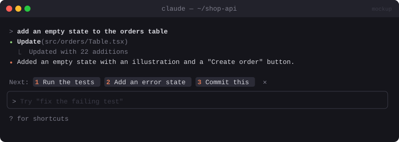

# 👣 Next Steps

> After each turn, suggests three logical next actions as buttons. One press puts the action in your prompt.


<sub>Mockup: an illustration of the idea. Your build may look different.</sub>

[← All mods](../../README.md)

| | |
|---|---|
| **Category** | Prompting & Flow |
| **Surfaces** | Band above prompt |
| **Difficulty** | 🟢 Easy |

## Ready-made version

A community version exists in **hamzafer/claude-code-mods** ([repo](https://github.com/hamzafer/claude-code-mods)). Read the code before installing: mods run with your permissions.

```bash
claude plugin marketplace add hamzafer/claude-code-mods
claude plugin install next-steps@claude-code-mods
```

## What it does

- When a turn ends, shows a dismissible band:
  `Next: [1 Run the tests] [2 Add an error state] [3 Commit this]  ✕`
- Pressing a number fills the prompt bar so you can edit before sending. Hold **shift** (or use the ➤ button) to send it straight away.
- Suggestions are specific to what just happened, not generic advice.

## Build prompt

```text
Use the plugin-authoring skill to build a Claude Code mod named "next-steps".

Requirements:
1. On turn.complete (main conversation only, skip subagents and turns under 5 seconds), call
   $.model.fork with: "Suggest exactly 3 concrete next steps the user would most likely want,
   given this conversation. Each under 8 words, imperative. JSON array of strings." Use
   maxTokens ~100.
2. Draw a band above the prompt: "Next:" plus three Buttons with hotkeys 1, 2, 3 and a
   dismiss button.
3. Pressing a button calls $.prompt.fill with the suggestion (replace mode) so I can edit it.
   Add a small ➤ per item that submits it directly with $.prompt.submit.
4. Hide the band when I start typing or submit a prompt.
5. userConfig "auto" (default true). When false, only show suggestions after "/next".

Write a test with a mocked fork reply and run `claude plugin validate`.
```

## Under the hood

| Need | Mod API |
|---|---|
| Cheap suggestions over the transcript | `$.model.fork` (prompt cache) |
| Buttons → prompt | `AbovePrompt`, `Button hotkey`, `$.prompt.fill`, `$.prompt.submit` |

## Gotchas

- Claude Code already shows a dimmed suggestion in the prompt (`prompt.suggest`). This mod offers three choices, and you can hide the built-in one with a `prompt.suggest` hook if you like.
- Each suggestion costs one forked call per turn: cheap thanks to the cache, but not free.
