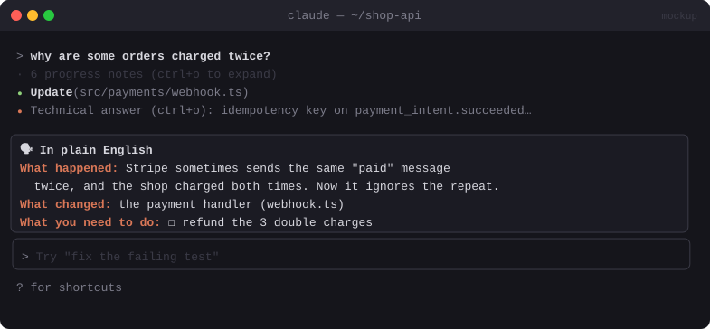

# 🗣️ No-Jargon Summarizer

> Collapses the play-by-play chatter of long tasks and ends with a plain-English summary: what changed, and what you need to do next.


<sub>Mockup: an illustration of the idea. Your build may look different.</sub>

[← All mods](../../README.md)

| | |
|---|---|
| **Category** | Prompting & Flow |
| **Surfaces** | Transcript rows (display-only) · pane or notice |
| **Difficulty** | 🟡 Medium |

## What it does

- During multi-step turns, the short "Now I'll look at…" messages between tool calls collapse into one dim line: `· 6 progress notes (ctrl+o to expand)`.
- When the turn ends, a fast model rewrites the final answer into a **plain-English card**:
  - **What happened:** 2–3 sentences, no jargon
  - **What changed:** files and features
  - **What you need to do:** checklist (or "Nothing")
- The full technical answer is still there, one keypress away.

## Build prompt

```text
Use the plugin-authoring skill to build a Claude Code mod named "no-jargon-summarizer".

Requirements:
1. Hook ui.render for assistant message rows. For text-only messages that sit between tool
   calls in the same turn (not the final one), draw a single dim line instead
   ("· progress note"), grouping runs into "· N progress notes". When the row is expanded
   (e.props.isExpanded), return next(e) so the full text shows. Display only: never rewrite
   session.append.
2. On turn.complete, if the turn had 5+ tool calls, send the final assistant text to
   $.model.complete with a small fast model: "Rewrite for a smart non-engineer. Sections:
   What happened (≤3 sentences), What changed (bullets), What you need to do (checklist or
   'Nothing'). No jargon, keep exact file names and commands."
3. Show the result as a Markdown card in the transcript via $.session.append with
   type "system" (a notice: the model never reads it), or in a pane if notices aren't wanted.
4. Add "/plain" to toggle the mod and "/plain last" to re-summarise the last turn.
5. Skip all of this for short turns (< 5 tool calls).

Write a test for the grouping logic and the short-turn skip and run `claude plugin validate`.
```

## Under the hood

| Need | Mod API |
|---|---|
| Collapse chatter (screen only) | `ui.render` on assistant rows; `next(e)` when `isExpanded` |
| Rewrite | `$.model.complete` |
| Show the card | `$.session.append({ message: { type: 'system', ... } })` or a `Pane` |

## Gotchas

- Never rewrite what the model reads. Collapsing is visual only, so Claude keeps its own context intact.
- Summaries can drop nuance. Keep exact file names, commands and numbers verbatim.
