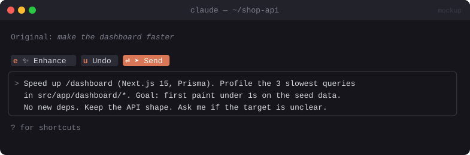

# ✨ Prompt Enhancer

> An **Enhance** button that rewrites a vague prompt into a specific one in place, so you can review it before sending.


<sub>Mockup: an illustration of the idea. Your build may look different.</sub>

[← All mods](../../README.md)

| | |
|---|---|
| **Category** | Prompting & Flow |
| **Surfaces** | Band above prompt · slash command |
| **Difficulty** | 🟢 Easy |

## What it does

- A small band above the prompt: `[✨ Enhance]` `[➤ Send]` (also `/enhance`).
- **Enhance** takes what you've typed, e.g. *"make the dashboard faster"*, and replaces it with a sharper version: scope, files to look at, acceptance criteria, constraints, and "ask me if X is unclear".
- It uses the project's context (stack from `package.json` / `pyproject.toml`, `CLAUDE.md` rules) so the rewrite fits your repo.
- **Undo** puts your original text back.

## Build prompt

```text
Use the plugin-authoring skill to build a Claude Code mod named "prompt-enhancer".

Requirements:
1. Draw a one-line band above the prompt with [✨ Enhance] and [➤ Send] buttons, shown only
   while the prompt bar has 3+ words ($.prompt.read).
2. Enhance: read the draft with $.prompt.read, gather light context (first 40 lines of
   CLAUDE.md, the stack from package.json/pyproject.toml/go.mod), and call $.model.complete
   with a small fast model and a system prompt that rewrites the draft into a precise task:
   goal, relevant files/areas, acceptance criteria, constraints, and one line on what to ask
   if unclear. Keep my intent, don't invent requirements, max ~120 words.
3. Replace the prompt bar text with the result via $.prompt.fill. Keep the original in
   $.state and show an [↩ Undo] button until I send.
4. Send: submit the current prompt text.
5. Add "/enhance <text>" which does the same for the given text.

Write a test for the fill/undo flow with a mocked model reply and run `claude plugin validate`.
```

## Under the hood

| Need | Mod API |
|---|---|
| Read and replace the draft | `$.prompt.read`, `$.prompt.fill` |
| Rewrite | `$.model.complete` (small model, low `maxTokens`) |
| Buttons | `AbovePrompt` band |

## Try it

Type *"fix the bug in auth"* and press **Enhance**.

## Gotchas

- Over-specified prompts can mislead Claude. Tell the rewriter not to invent requirements.
- If `$.prompt.read` isn't available on a surface, fall back to `/enhance <text>`.
