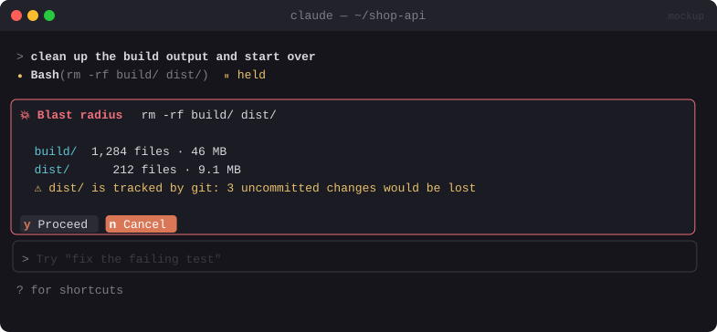

# 💥 Blast Radius

> Before a destructive command runs, shows exactly what it will delete or overwrite and waits for you to approve.


<sub>Mockup: an illustration of the idea. Your build may look different.</sub>

[← All mods](../../README.md)

| | |
|---|---|
| **Category** | Safety & Guardrails |
| **Surfaces** | Tool-call guard · focused pane (dialog) |
| **Difficulty** | 🔴 Hard |
| **Source** | **Anthropic sample** in [anthropics/claude-code-playground](https://github.com/anthropics/claude-code-playground/tree/main/claude-code/mods/blast-radius) |

## Ready-made version

Anthropic publishes it as an example mod, shared as-is without support. Its marketplace lives in a subfolder, so clone the repo and add that folder:

```bash
git clone https://github.com/anthropics/claude-code-playground
cd claude-code-playground/claude-code/mods
claude plugin marketplace add ./
claude plugin install blast-radius@claude-code-playground-mods --scope user
```

A community port is also in [hamzafer/claude-code-mods](https://github.com/hamzafer/claude-code-mods) (`blast-radius@claude-code-mods`).

## What it does

- Intercepts risky `Bash` calls before they run:
  `rm -r/-rf`, `git clean -fd`, `git reset --hard`, `git checkout -- .`, `git push --force`, `find … -delete`, `mv`/`cp` onto existing paths, `truncate`, `> file` overwrites, `DROP`/`TRUNCATE`/`DELETE` without `WHERE` in `psql`/`mysql`/`sqlite3`, `kubectl delete`, `terraform destroy`.
- Also flags a `Write` that would replace a large existing file.
- Works out the **blast radius**: the files and folders affected, with counts and total size (`rm -rf build/` → *1,284 files · 46 MB*), and the uncommitted changes that would be lost for git commands.
- Opens a **dialog** with the list and `[Proceed]` `[Cancel]`. Cancel tells Claude why.
- **Fails closed:** if the analysis itself errors, the command is blocked.

## Build prompt

```text
Use the plugin-authoring skill to build a Claude Code mod named "blast-radius".

Requirements:
1. Hook tool.call for Bash. Parse the command (handle &&, ;, pipes, sudo, xargs) and match it
   against a list of destructive patterns: rm -r/-rf, git clean -f*, git reset --hard,
   git checkout -- <path>, git push --force/-f, find ... -delete, truncate, "> existing-file",
   SQL DROP/TRUNCATE/DELETE-without-WHERE, kubectl delete, terraform destroy.
   Also hook Write when the target exists and is over 200 lines.
2. Work out the impact: for path deletions, resolve paths with $.fs.stat(path, {resolve:true})
   and count files/size with $.fs.list (cap the walk at 10k entries and say "10k+"). For git
   commands, run `git status --porcelain` / `git diff --stat` via $.process.run to show what
   would be lost. For SQL, show the statement and target.
3. Open a focused dialog pane (focus, closeOnEscape) titled "💥 Blast radius" listing the top
   50 affected paths plus totals, with [Proceed] (hotkey p) and [Cancel] (hotkey c, default).
4. Proceed → let the call through with next(e). Cancel or Esc → return { deny } with a short
   reason Claude can read, e.g. "User cancelled: would delete 1,284 files under build/".
5. Fail closed: register the hook with .catch(($, e, next) => next.called ? next(e) :
   { deny: "blast-radius could not analyse this command" }).
6. Allow-list in userConfig (e.g. rm -rf node_modules, dist, .next) that skips the dialog.

Write tests for the parser (at least 15 commands, safe and risky) and for the fail-closed
path and run `claude plugin validate`.
```

## Under the hood

| Need | Mod API |
|---|---|
| Intercept | `on('tool.call', { tool: 'Bash' }, ...)` → `{ deny }` or `next(e)` |
| Resolve real paths | `$.fs.stat(p, { resolve: true }).realPath` |
| Measure impact | `$.fs.list`, `$.process.run(['git', ...])` |
| Dialog | `$.ui.open({ focus, closeOnEscape, holdToasts })` |
| Fail closed | `.catch(...)` on the registration |

## Try it

```bash
mkdir -p /tmp/br-test && touch /tmp/br-test/{a,b,c}.txt
```
Then ask Claude to *"delete /tmp/br-test"* and you should get the dialog.

## Gotchas

- A list of dangerous patterns is best effort, since shell is too expressive to catch everything. Pair it with Claude Code's own permission rules, not instead of them.
- Make sure a parser bug can't wave a command through. Test the fail-closed path.
