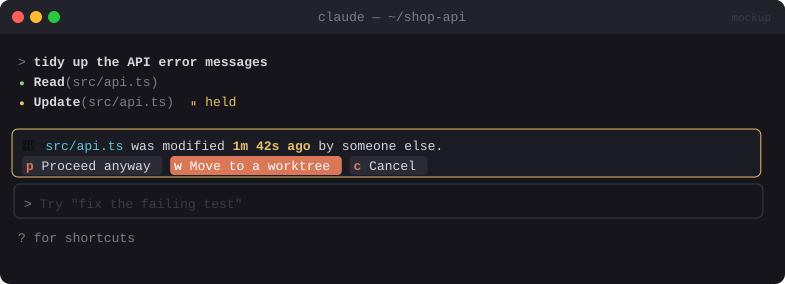

# 🚧 Collision Guard

> Stops Claude from overwriting a file that you (or another agent) changed in the last few minutes, and offers a worktree instead.


<sub>Mockup: an illustration of the idea. Your build may look different.</sub>

[← All mods](../../README.md)

| | |
|---|---|
| **Category** | Safety & Guardrails |
| **Surfaces** | Tool-call guard · focused pane (dialog) |
| **Difficulty** | 🟡 Medium |

## What it does

- Before any `Edit`, `Write` or `NotebookEdit`, checks the file's modified time.
- If it changed in the last **N minutes** (default 5) and **this session didn't make the change**, it pauses with:
  *"`src/api.ts` was modified 1m 42s ago by someone else."*
  `[Proceed anyway]` `[Move to a worktree]` `[Cancel]`
- **Move to a worktree** creates `../<repo>-claude-<branch>` with `git worktree add` and tells Claude to make its changes there instead.

## Build prompt

```text
Use the plugin-authoring skill to build a Claude Code mod named "collision-guard".

Requirements:
1. Hook tool.call for Edit, Write and NotebookEdit. Keep a map in $.state of
   path → mtime right after this session's own successful writes (await next(e), then $.fs.stat).
2. Before a write, $.fs.stat the target. If mtime is within the window (userConfig, default
   5 min) and doesn't match the mtime we recorded ourselves, hold the call and open a focused
   dialog pane: file path, "modified X ago", and `git diff --stat -- <file>` if it's a repo.
3. Buttons: [Proceed anyway] → next(e). [Move to a worktree] → run
   `git worktree add ../<repo>-claude-<short-id> -b claude/<short-id>` via $.process.run,
   then deny with a reason telling Claude to redo the change in that worktree path.
   [Cancel] → deny with "User cancelled: file was modified recently by someone else".
4. Remember "Proceed anyway" per file for 10 minutes so I'm not asked again and again.
5. Fail open on errors (this is a convenience guard), but log them with $.ui.log.

Write a test where the file's mtime is recent vs old vs our own write and run
`claude plugin validate`.
```

## Under the hood

| Need | Mod API |
|---|---|
| Intercept writes | `tool.call` with a matcher on the edit tools |
| Freshness check | `$.fs.stat(path).mtimeMs`, `$.session.usage().startedAt` |
| Worktree | `$.process.run(['git','worktree','add', ...])` |

## Try it

Open a file in your editor, save a change, then within 5 minutes ask Claude to edit the same file.

## Gotchas

- Claude Code's `Edit` already refuses when a file changed since Claude last read it. This guard adds a time window, covers `Write`, and offers the worktree escape.
- Pairs well with [Same Folder Tracker](../multi-session/same-folder-tracker.md).
