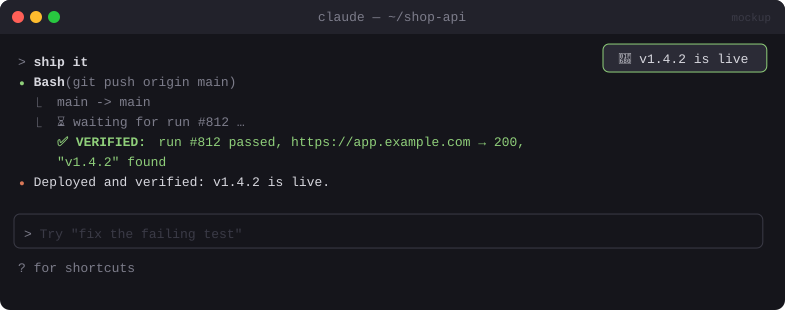

# 🚀 Deploy Verify

> After a deploy command, waits for CI, checks the live URL, and tells Claude the real result. Claude can't say "deployed!" without proof.


<sub>Mockup: an illustration of the idea. Your build may look different.</sub>

[← All mods](../../README.md)

| | |
|---|---|
| **Category** | Safety & Guardrails |
| **Surfaces** | Tool-call result hook · model context · toast |
| **Difficulty** | 🟡 Medium |

## What it does

- Recognises deploy commands (`vercel --prod`, `git push` to a deploy branch, `fly deploy`, and others you configure).
- After the command succeeds: polls `gh run list` for the run it triggered → waits for it to finish → `curl`s your live URL with a cache-buster.
- Adds `✅ VERIFIED: run #812 passed, https://app.example.com → 200, "v1.4.2" found` (or `❌ FAILED: …`) to the tool result Claude reads, and shows a toast.

## Build prompt

```text
Use the plugin-authoring skill to build a Claude Code mod named "deploy-verify".

Requirements:
1. userConfig: deployPatterns (regex list, default vercel --prod, fly deploy,
   git push .* (main|production)), liveUrl, expectText (optional).
2. Hook tool.call for Bash. await next(e); if the command matched and succeeded, poll
   `gh run list --limit 5 --json databaseId,headSha,status,conclusion` (via $.process.run) for
   the run on the pushed SHA until it completes (timeout 10 min, every 15 s, respect next.signal).
3. Then fetch liveUrl?cb=<timestamp> with $.http.fetch and record status and whether expectText
   appears.
4. Append "VERIFIED: …" or "FAILED: …" to the tool result text so Claude reads the verdict,
   and show a toast.
5. If gh is missing, still do the URL check and say CI wasn't checked.

Write tests for pattern matching and verdict formatting with mocked gh/http and run
`claude plugin validate`.
```

## Gotchas

- A hook has a time budget for each dispatch. For long CI runs, start the polling from a timer and add the verdict with `$.session.append` when it arrives, instead of holding the tool call open.
