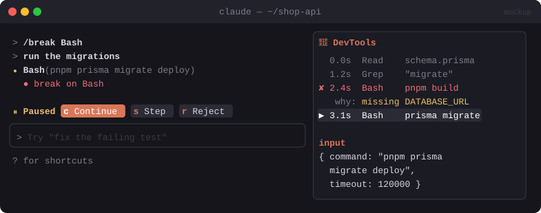

# 🐞 DevTools

> A debugger for Claude's tool calls: set breakpoints on tools, paths or failures, then Continue, Step or Reject. Includes a timeline and inspector pane.


<sub>Mockup: an illustration of the idea. Your build may look different.</sub>

[← All mods](../../README.md)

| | |
|---|---|
| **Category** | Safety & Guardrails |
| **Surfaces** | Tool-call hold · pane · transcript rows · slash command |
| **Difficulty** | 🔴 Hard |

## What it does

- `/break Bash`, `/break /src/db/**`, `/break on-error` set breakpoints, which are remembered.
- When a call matches, it **pauses**: `[Continue] [Step] [Reject]`. Step pauses on the next call too.
- A dim `● break on Bash` marker under matched tool rows.
- A **DevTools pane** with the call timeline and an inspector for the selected call's input/output.
- **Error Lens**: failed calls get a short "why it failed" line.

## Build prompt

```text
Use the plugin-authoring skill to build a Claude Code mod named "devtools".

Requirements:
1. "/break <tool|regex|path-glob|on-error>", "/break list", "/break clear". Keep breakpoints
   in $.store.
2. Hook tool.call: on a match, hold the call and ask Continue / Step / Reject (a focused
   dialog pane). Step sets a one-shot breakpoint on the next call. Reject returns { deny }.
3. Under matched tool rows (ui.render), add a dim "● break on <rule>" line.
4. "/devtools" opens a pane: a timeline of the session's calls (tool, short input, duration,
   ok/error) and an inspector showing full input/output of the selected one.
5. For failed calls, add a one-line explanation (first error line + exit code). No network
   or model calls.

Write tests for breakpoint matching and the Step flow and run `claude plugin validate`.
```
