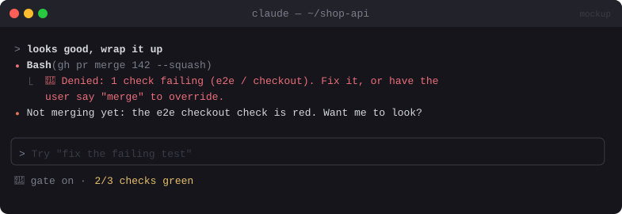

# 🚦 Merge Gate

> Holds `gh pr merge` and pushes to `main` until CI is green, and optionally until a second model has reviewed the change.


<sub>Mockup: an illustration of the idea. Your build may look different.</sub>

[← All mods](../../README.md)

| | |
|---|---|
| **Category** | Safety & Guardrails |
| **Surfaces** | Tool-call guard · slash command |
| **Difficulty** | 🟢 Easy |

## What it does

- Catches `gh pr merge`, `git merge` into trunk, and `git push` to `main`/`master`.
- **Denies** unless `gh pr checks` is all green, and (optionally) a second-model review has passed, or your latest message literally says "merge".
- `/gate` shows status. `/gate off` disables it for the session.

## Build prompt

```text
Use the plugin-authoring skill to build a Claude Code mod named "merge-gate".

Requirements:
1. Hook tool.call for Bash; match gh pr merge, git merge on main/master, and git push to
   main/master (including "HEAD:main" and force variants).
2. Allow only if: `gh pr checks <pr> --json state` shows all success, AND (when userConfig
   requireReview is on) a review pass ran: $.model.complete on `gh pr diff` with a strict
   reviewer prompt returning {approve: boolean, issues: string[]}.
3. userConfig requireWord (default off): if on, also require my latest prompt to contain
   the word "merge".
4. On deny, return a reason Claude can act on ("2 checks failing: lint, e2e").
5. "/gate" shows the status and the last decision; "/gate off|on" toggles for the session.
   Fail closed with .catch.

Write tests for the matcher and each deny reason and run `claude plugin validate`.
```
