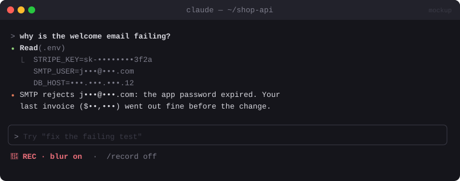

# 🙈 Privacy Blur

> `/record on` masks emails, API keys and money figures on screen while you record or screen-share. Claude still sees the real data.


<sub>Mockup: an illustration of the idea. Your build may look different.</sub>

[← All mods](../../README.md)

| | |
|---|---|
| **Category** | Safety & Guardrails |
| **Surfaces** | Transcript rows (display-only rewrite) · status line · slash command |
| **Difficulty** | 🟡 Medium |
| **Source** | [nateherkai/claude-code-mods](https://github.com/nateherkai/claude-code-mods) (as **Recording Mode**) |

## Ready-made version

A published version ships as **Recording Mode** (`/rec`, `/rec strict`, `/rec off`, `/rec config`). It masks keys, personal details and business figures on screen and keeps private files closed while you record.

```bash
claude plugin marketplace add nateherkai/claude-code-mods
claude plugin install recording-mode@nateherk-mods
```

> Want secrets kept away from **the model** too, not just the screen? See [Secret Redactor](secret-redactor.md).

## What it does

- `/record on` / `/record off`. While on, the status line shows `🔴 REC · blur on`.
- Rewrites **only what's drawn**, not what's stored or sent:
  - emails → `j•••@•••.com`
  - API keys and tokens (`sk-…`, `ghp_…`, `AKIA…`, JWTs, long hex/base64) → `sk-••••••••3f2a`
  - money figures → `$••,•••`
  - phone numbers, IPs and your own custom patterns (from config)
- The model, the transcript file and the files on disk are untouched. It's purely visual.

## Build prompt

```text
Use the plugin-authoring skill to build a Claude Code mod named "privacy-blur".

Requirements:
1. Add "/record on" and "/record off" (and "/record" to toggle). Keep the flag in $.state and
   show "🔴 REC · blur on" in the status line while on.
2. While on, hook ui.render for transcript rows (user prompts, assistant messages, tool-use
   rows and their output) and rewrite only the drawn text props via next({ ...e, props }).
   Never touch session.append or tool inputs, so the model and files get the real data.
3. Masks: emails, API keys/tokens (sk-, ghp_, github_pat_, xox[bap]-, AKIA, JWT, 32+ char
   hex/base64), money amounts, phone numbers, IPv4. Keep the last 4 characters of keys.
4. Extra regexes from userConfig "patterns" (e.g. a client name).
5. When toggled, invalidate so rows already on screen redraw masked/unmasked.

Write tests for each mask type and one proving the model-facing text is unchanged and run
`claude plugin validate`.
```

## Under the hood

| Need | Mod API |
|---|---|
| Visual-only rewrite | `ui.render` → `next({ ...e, props: masked })` (a rewritten row changes the screen, never what the model read) |
| Toggle | `$.command.register`, `$.state`, `$.ui.status`, `$.ui.invalidate` |

## Try it

`/record on`, then ask Claude to `cat .env.example` or print a fake key.

## Gotchas

- It only masks what Claude Code draws. Your terminal's scrollback from before `/record on`, and other apps, aren't covered. Turn it on **before** you start sharing.
- Check the expanded view (ctrl+o) too. A hook that returns `next(e)` there would show the raw text.
