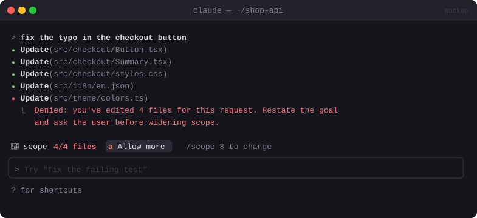

# 🧯 Scope Guard

> Counts the files a turn edits. Past a limit, it stops and makes Claude restate the goal, so a small fix can't quietly grow into a refactor.


<sub>Mockup: an illustration of the idea. Your build may look different.</sub>

[← All mods](../../README.md)

| | |
|---|---|
| **Category** | Safety & Guardrails |
| **Surfaces** | Tool-call guard · band above prompt · slash command |
| **Difficulty** | 🟢 Easy |
| **Source** | [yash-gadodia/claude-mods](https://github.com/yash-gadodia/claude-mods/tree/main/scope-guard) |

## Ready-made version

```bash
claude plugin marketplace add yash-gadodia/claude-mods
claude plugin install scope-guard@claude-mods
```

## What it does

- A band line while a turn edits: `🧯 scope 3/4 files`.
- On file N+1 it **denies the edit** with a message to Claude: *"You've edited 4 files for this request. Restate the goal and ask the user before widening scope."*
- `/scope 8` changes the limit (it's remembered). A one-press **Allow more** button lifts it for the current turn.

## Build prompt

```text
Use the plugin-authoring skill to build a Claude Code mod named "scope-guard".

Requirements:
1. Hook tool.call for Edit, Write and NotebookEdit and keep a set of distinct file paths for
   the current request. Reset on each prompt.submit.
2. Band above the prompt while the set is non-empty: "🧯 scope n/limit files".
3. When a new path would exceed the limit, return { deny } with: "Scope limit reached
   (limit files). Restate the goal in one sentence and ask the user before editing more files."
4. "/scope <N>" sets the limit (default 4), kept in $.store.
5. Show an [Allow more] button in the band that raises the limit by 4 for this request only.

Write a test that edits 5 files with a limit of 4 and run `claude plugin validate`.
```
