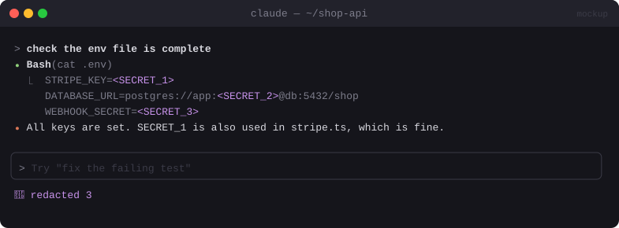

# 🔐 Secret Redactor

> Replaces API keys, emails and IPs in tool output with stable placeholders **before the model reads them**, and puts the real values back only when writing files.


<sub>Mockup: an illustration of the idea. Your build may look different.</sub>

[← All mods](../../README.md)

| | |
|---|---|
| **Category** | Safety & Guardrails |
| **Surfaces** | Tool-result rewrite · tool-input rewrite · status line |
| **Difficulty** | 🔴 Hard |
| **Source** | [karanb192/claude-code-redact](https://github.com/karanb192/claude-code-redact) · similar: [ray-amjad/awesome-claude-code-function-hooks](https://github.com/ray-amjad/awesome-claude-code-function-hooks/tree/main/plugins/secret-redactor) |

## Ready-made version

```bash
claude plugin marketplace add karanb192/claude-code-redact
claude plugin install redact@claude-code-redact
```

## What it does

- `cat .env` → Claude sees `STRIPE_KEY=<SECRET_1>` instead of the real key.
- The same value always maps to the same placeholder, so Claude can still reason about it ("SECRET_1 is used in two places").
- When Claude writes `<SECRET_1>` into an `Edit`/`Write`, the real value goes to disk.
- Status line: `🔐 redacted 4`. No network or model calls.

> Compared with [Privacy Blur](privacy-blur.md): Privacy Blur hides secrets **from the screen**. This one hides them **from the model**.

## Build prompt

```text
Use the plugin-authoring skill to build a Claude Code mod named "secret-redactor".

Requirements:
1. Detectors (regex): AWS keys, sk-/sk-ant-, ghp_/github_pat_, xox[bap]-, JWTs, private key
   blocks, emails, IPv4, plus custom patterns from userConfig.
2. Hook tool.call for Read, Bash, Grep (and WebFetch): await next(e), then rewrite the result
   text, mapping each distinct value to a stable <SECRET_n> held in $.state for the session.
3. Hook tool.call for Edit and Write: replace <SECRET_n> tokens in the input with the real
   values before letting the call through.
4. Never make network or model calls; never log real values.
5. Status line "🔐 redacted N". "/redact list" shows placeholder → kind (never the value).

Write tests for each detector, stable mapping, and the round-trip into a file write and run
`claude plugin validate`.
```

## Gotchas

- What you type yourself and what's in `CLAUDE.md` reach the model directly. Redaction covers tool output only.
- Run it with fail-closed `.catch` on the result rewrite, or a thrown error would pass the raw secret through.
