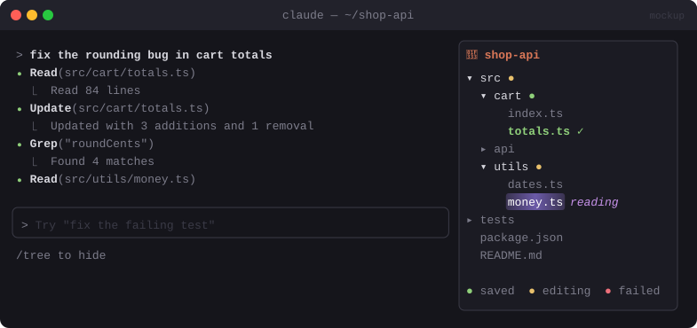

# 🌳 File Tree

> A file panel that lights up the files Claude is reading or editing, and turns them green once a change is saved.


<sub>Mockup: an illustration of the idea. Your build may look different.</sub>

[← All mods](../../README.md)

| | |
|---|---|
| **Category** | Visibility & Awareness |
| **Surfaces** | Pane · slash command |
| **Difficulty** | 🟡 Medium |

## What it does

- A collapsible **project tree** in a pane on the right. It respects `.gitignore` and skips `node_modules` and `.git`.
- **Shimmer** (a pulsing highlight) on the file Claude is reading or searching right now.
- **Amber** while an edit is in flight, **green** once the edit succeeded, **red** if it failed. Green stays for the rest of the session.
- Folders that contain touched files are expanded automatically and show a dot.
- `/tree` toggles the pane. `/tree reset` clears the colours.

## Build prompt

```text
Use the plugin-authoring skill to build a Claude Code mod named "file-tree".

Requirements:
1. Add "/tree" to open/close a pane titled "Files" showing the project tree from
   $.session.root(). Use `git ls-files` via $.process.run when it's a git repo (so ignored
   files are skipped), else $.fs.list while skipping node_modules, .git, dist and build.
2. Hook tool.call for Read, Grep, Glob, Edit, Write and NotebookEdit. While a call is in
   flight, make its file "shimmer" (alternate two highlight colours with $.clock.every,
   about every 300 ms, and stop when the call ends).
3. After an Edit/Write result: green if it succeeded, red if it errored. Keep green for the
   whole session, held in $.state.
4. Auto-expand folders containing touched files and mark them with a dot. Collapse/expand
   folders by clicking or pressing Enter on them.
5. Add "/tree reset" to clear all highlights. Refresh the tree when files are created.

Write a test that simulates a Read then a successful Edit and checks the file's state and
run `claude plugin validate`.
```

## Under the hood

| Need | Mod API |
|---|---|
| Tree data | `$.process.run(["git","ls-files"])` / `$.fs.list` |
| File activity | `tool.call` with a tool matcher, `await next(e)` for success/failure |
| Shimmer | `$.clock.every` + a state flip |
| Pane + clicks | `$.ui.open`, `Pane`, `Button` rows, `ui.press` |

## Try it

1. `/tree`, then ask Claude to *"rename the helper in utils and update its callers"*.
2. Watch the files shimmer as they're read, then go green.

## Gotchas

- In big monorepos, show touched files and their parents first, and load the rest when a folder is expanded.
- Stop the shimmer timer in `turn.complete` as well, in case a tool call never resolves.
