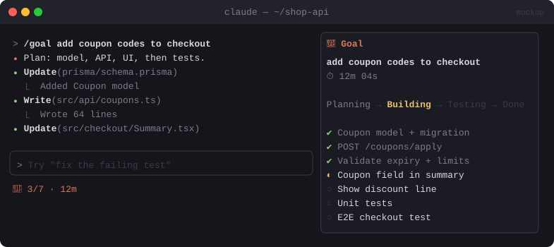

# 🎯 Goal Tracker

> A `/goal` command that pins your objective in a panel with a timer, the current phase and a live checklist.


<sub>Mockup: an illustration of the idea. Your build may look different.</sub>

[← All mods](../../README.md)

| | |
|---|---|
| **Category** | Visibility & Awareness |
| **Surfaces** | Pane · slash command · status line |
| **Difficulty** | 🟢 Easy |

## What it does

- `/goal <text>` sets the goal and sends it to Claude as the task.
- A **Goal pane** shows the goal, elapsed time and the phase: *Planning → Building → Testing → Done*.
- When Claude writes a todo list, the pane mirrors it as a checklist and ticks items off as they complete.
- The status line shows a short version: `🎯 3/7 · 12m`.

## Build prompt

```text
Use the plugin-authoring skill to build a Claude Code mod named "goal-tracker".

Requirements:
1. Add "/goal <text>". It stores the goal and start time in $.state, opens a pane titled
   "Goal", and submits the goal to Claude as a prompt ($.prompt.submit).
2. In the pane, show the goal, a live elapsed timer ($.clock.every, once per second) and a
   phase label: Planning until the first todo list appears, Building while edits happen,
   Testing while test commands run in Bash, Done when every item is complete.
3. Mirror Claude's todo list: hook the todo/task tool calls and draw the items as a checklist
   (☐ / ◐ in progress / ☑), updating in real time.
4. Put a compact summary in the status line: "🎯 done/total · elapsed".
5. "/goal done" closes it out with a toast showing the total time. "/goal" with no argument
   reopens the pane.

Write a test that feeds two todo updates and checks the checklist and run
`claude plugin validate`.
```

## Under the hood

| Need | Mod API |
|---|---|
| Command + kickoff | `$.command.register`, `command.run`, `$.prompt.submit` |
| Checklist source | `tool.call` on the todo/task tools |
| Timer | `$.clock.every` + `$.ui.status` |

## Try it

`/goal add dark mode to the settings page with a toggle and tests`. Then watch the checklist fill in and tick off.

## Gotchas

- Claude Code already shows its own todo list. This mod mirrors it in a pane that stays visible, with timing on top.
- The tool names for todos have changed between versions. Check `claude-code-tools/index.d.ts` for your build.
