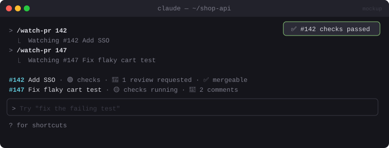

# 🔀 PR Tracker

> Watch GitHub pull requests from your session: merge state, reviews and checks above the prompt, plus a toast when something changes.


<sub>Mockup: an illustration of the idea. Your build may look different.</sub>

[← All mods](../../README.md)

| | |
|---|---|
| **Category** | Visibility & Awareness |
| **Surfaces** | Band above prompt · toast · slash command |
| **Difficulty** | 🟢 Easy |

## What it does

- `/watch-pr 142` (or a PR URL) adds it to your watch list. `/unwatch-pr 142` removes it.
- One band line per PR: `#142 Add SSO · 🟢 checks · 👀 1 review requested · ✅ mergeable`
- A toast when a PR's checks finish, a review lands or it merges.

## Build prompt

```text
Use the plugin-authoring skill to build a Claude Code mod named "pr-tracker".

Requirements:
1. "/watch-pr <number|url>" and "/unwatch-pr <number|url>" manage a list in $.store (per
   repo, from $.session.root()).
2. Every 60 s ($.clock.every), for each PR run
   `gh pr view <n> --json number,title,state,mergeable,reviewDecision,statusCheckRollup`
   via $.process.run.
3. Draw one band line per PR above the prompt: number, short title, checks icon
   (🟢/🟡/🔴), review state, mergeable/merged.
4. Toast on change (checks finished, review decision changed, merged/closed). Drop merged or
   closed PRs from the list after 10 min.
5. If gh isn't installed or authenticated, show one clear line saying so and stop polling.

Write a test with mocked gh output for a state change and run `claude plugin validate`.
```
