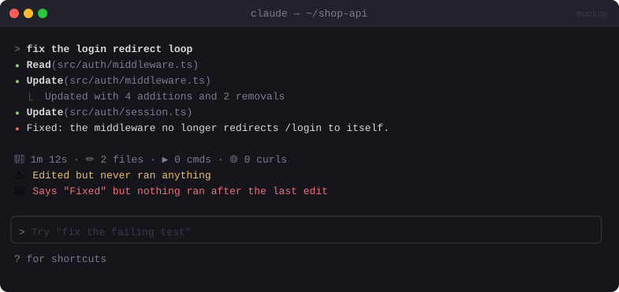

# 🧾 Receipt

> Replaces the end-of-turn line with a receipt of what actually happened, and flags "fixed" claims that nothing verified.


<sub>Mockup: an illustration of the idea. Your build may look different.</sub>

[← All mods](../../README.md)

| | |
|---|---|
| **Category** | Visibility & Awareness |
| **Surfaces** | Turn-duration line · spinner · toast |
| **Difficulty** | 🟡 Medium |

## What it does

- Instead of `Cooked for 1m 12s`, you get:
  `🧾 1m 12s · ✏️ 4 files · ▶ 6 cmds (1 failed) · 🌐 2 curls`
- ⚠️ **Edited but never ran anything**: files changed with no test or build run.
- 🚩 **Unverified claim**: the reply says "fixed", "done" or "works" but no command ran after the last edit.
- Never hides a destructive command inside a collapsed tool group.

## Build prompt

```text
Use the plugin-authoring skill to build a Claude Code mod named "receipt".

Requirements:
1. Per turn, count from tool.call (awaiting results): distinct files edited/written, Bash
   commands run and how many failed, and curl/WebFetch calls.
2. Hook ui.render on the turn-duration line and draw a one-line receipt:
   "🧾 <time> · ✏️ N files · ▶ M cmds (F failed) · 🌐 K fetches".
3. If there were edits and no Bash run whose command matches test/build/lint/typecheck after
   the last edit, add "⚠️ not run".
4. If the final reply contains "fixed|done|works|resolved|should now" and nothing ran after the
   last edit, add "🚩 unverified claim" and show a toast.
5. If a tool group is collapsed, never fold a destructive Bash command (rm -rf, reset --hard,
   push --force) into it: keep that row visible.

Write tests for the counting and both warnings and run `claude plugin validate`.
```
