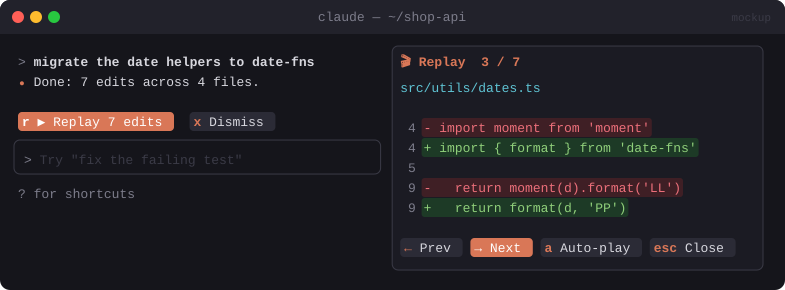

# 🎬 Replay Theater

> After a turn that edited several files, a ▶ Replay button steps you through every edit, one diff at a time.


<sub>Mockup: an illustration of the idea. Your build may look different.</sub>

[← All mods](../../README.md)

| | |
|---|---|
| **Category** | Visibility & Awareness |
| **Surfaces** | Band above prompt · Pane |
| **Difficulty** | 🟡 Medium |

## What it does

- Records every `Edit`, `Write` and `NotebookEdit` during a turn, with the old and new text.
- When a turn ends with **3 or more edits** (configurable), a band offers `[▶ Replay 7 edits]`.
- **Theater pane**: one edit per page with file path, step `3 / 7` and a coloured diff. Navigate with `← Prev` / `Next →` (or `h` / `l`) and `Esc` to close.
- An **Auto-play** button advances every 2 seconds.

## Build prompt

```text
Use the plugin-authoring skill to build a Claude Code mod named "replay-theater".

Requirements:
1. Hook tool.call for Edit, Write and NotebookEdit. Before the call, record the file path and
   its old content (or old_string/new_string for Edit). After a successful result, store the
   step in $.state for the current turn.
2. On turn.complete, if the turn has at least N edits (userConfig, default 3), show a band
   above the prompt with a "▶ Replay N edits" button and a dismiss button.
3. Pressing Replay opens a focused pane titled "Replay" showing one step at a time: file path,
   "step i / N", and a unified diff drawn with Code format "diff".
4. Buttons: Prev (hotkey h), Next (hotkey l), Auto-play (advance every 2 s with $.clock.every,
   press again to pause). Esc closes the pane.
5. Keep the last 5 turns' replays, and add "/replay" to reopen the most recent one.

Write a test that simulates three edits and steps through them and run
`claude plugin validate`.
```

## Under the hood

| Need | Mod API |
|---|---|
| Capture edits | `tool.call` matcher on edit tools; `$.fs.read` before, `await next(e)` after |
| End-of-turn trigger | `turn.complete` |
| Diff view | `Code` with `format: "diff"` inside a focused `Pane` |
| Hotkeys | `Button` `hotkey` props |

## Try it

Ask Claude to *"rename `User` to `Account` across the codebase"*, then press ▶ Replay.

## Gotchas

- Build diffs from the captured old/new text, not from `git diff`, so uncommitted work from before the turn doesn't show up as part of it.
- Large `Write`s (whole files) make long diffs. Show the first and last hunks and add an "expand" button.
