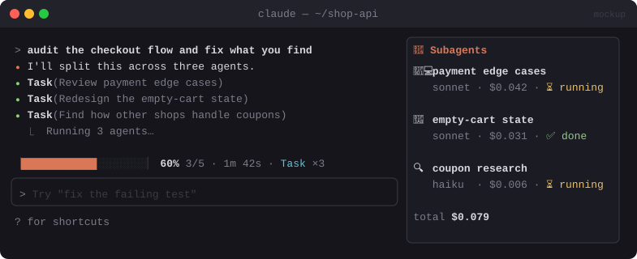

# 📊 Savvy Progress

> A live progress bar above your prompt, plus a side panel showing every running subagent's model, cost and status.


<sub>Mockup: an illustration of the idea. Your build may look different.</sub>

[← All mods](../../README.md)

| | |
|---|---|
| **Category** | Visibility & Awareness |
| **Surfaces** | Band above prompt · Pane |
| **Difficulty** | 🟡 Medium |

## What it does

- **Band above the prompt** while a turn runs: a progress bar, elapsed time, number of steps, and the tool running now.
- Progress comes from Claude's own todo list when there is one (done ÷ total). Without a list it shows an indeterminate bar.
- **Subagent pane**: opens by itself on wide terminals once a subagent is spawned. One card per agent shows its avatar, description, model, running cost and state (⏳ running / ✅ done / ❌ failed).
- Avatars are swappable: 🧑‍💻 developer, 🎨 designer, 🔍 researcher, picked from the agent type.

## Build prompt

```text
Use the plugin-authoring skill to build a Claude Code mod named "savvy-progress".

Requirements:
1. Draw a band above the prompt while a turn is running: a progress bar, elapsed time,
   step count (turn.step), and the name of the tool running now. Hide it when the turn ends.
2. Work out progress from Claude's todo list: watch the todo/task tool calls and use
   completed ÷ total. With no list, show an indeterminate bar.
3. When subagents are spawned (the Agent tool), open a pane titled "Agents" with one card
   per subagent: avatar, description, model, running token cost, and state
   (running/done/failed) from the tool result.
4. Pick avatars from the subagent type with a simple map (developer 🧑‍💻, designer 🎨,
   researcher 🔍, default 🤖). Make the map easy to edit.
5. Keep all of this in $.state so a hot reload doesn't wipe it, and show the session's total
   cost from $.session.usage() in the pane's footer.

Write a test that simulates a turn with two subagent calls and run `claude plugin validate`.
```

## Under the hood

| Need | Mod API |
|---|---|
| Turn lifecycle | `turn.start`, `turn.step`, `turn.complete` |
| Watch tools and subagents | `tool.call` (await `next(e)` for the result) |
| Band | `ui.render` on `{ component: 'AbovePrompt' }` |
| Agents pane | `$.ui.open` + `ui.render` on `Pane` |
| Cost | `$.session.usage()` → `cost` |

## Try it

1. Ask: *"Use three subagents in parallel to summarise the README, the tests and the package.json."*
2. You should see the band filling and three agent cards updating live.

## Gotchas

- Cost for each subagent is an estimate from token usage. The session total from `$.session.usage()` is the authoritative number.
- Keep the band to one or two lines. Tall bands push the transcript up on small terminals.
