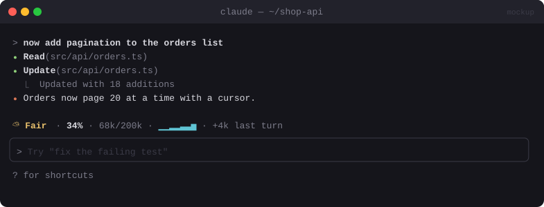

# 🌦️ Token Weather

> Shows how full your context window is as a weather forecast above the prompt, with a sparkline of recent turns.


<sub>Mockup: an illustration of the idea. Your build may look different.</sub>

[← All mods](../../README.md)

| | |
|---|---|
| **Category** | Visibility & Awareness |
| **Surfaces** | Band above prompt |
| **Difficulty** | 🟢 Easy |
| **Source** | **Anthropic sample**: [anthropics/claude-code-playground](https://github.com/anthropics/claude-code-playground/tree/main/claude-code/mods/token-weather) |

## Ready-made version

```bash
git clone https://github.com/anthropics/claude-code-playground
cd claude-code-playground/claude-code/mods
claude plugin marketplace add ./
claude plugin install token-weather@claude-code-playground-mods --scope user
```

## What it does

- One line above the prompt: `☀ Clear · 18% · 36k/200k · ▁▁▂▂▃▃▅ · +4k last turn`
- The forecast follows the fill level: ☀ Clear (<25%) → ⛅ Fair → 🌧 Showers → ⛈ Storm → ↯ Compact soon (90%+).
- A sparkline of the last 12 turns shows which turns ate the most context.
- It makes no extra API calls. Everything comes from the session's own usage numbers.

## Build prompt

```text
Use the plugin-authoring skill to build a Claude Code mod named "token-weather".

Requirements:
1. On session.start and turn.complete (main conversation only; skip subagent turns), read
   $.session.usage(): context tokens, window size, percent.
2. Draw one line above the prompt: an icon and word for the band (<25 ☀ Clear, 25–49 ⛅ Fair,
   50–74 🌧 Showers, 75–89 ⛈ Storm, 90+ ↯ Compact soon), the percent, and tokens/window.
3. Keep the last 12 turn totals in $.state and draw them as a ▁▂▃▄▅▆▇█ sparkline.
4. Show "+Nk last turn" (the difference from the previous reading).
5. Make no token-counting API calls.

Write a test for the band thresholds and sparkline scaling and run `claude plugin validate`.
```

## Under the hood

`turn.complete` → `$.session.usage()` → `$.state` → `ui.render` on `AbovePrompt`.
