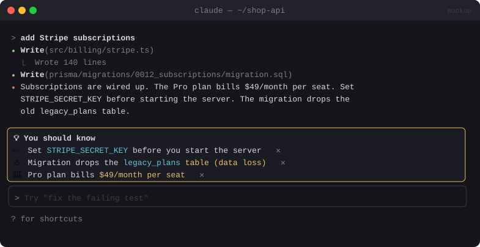

# 💡 You Should Know

> Watches Claude's replies for important details buried in long text (costs, security warnings, breaking changes, things you need to do) and pins them above your prompt.


<sub>Mockup: an illustration of the idea. Your build may look different.</sub>

[← All mods](../../README.md)

| | |
|---|---|
| **Category** | Visibility & Awareness |
| **Surfaces** | Band above prompt · toast |
| **Difficulty** | 🟡 Medium |
| **Source** | **Anthropic, built in** (`cc-plugin-you-should-know`) |

## Ready-made version

**It ships with Claude Code** but is off by default. Turn it on:

```text
/plugin enable cc-plugin-you-should-know@builtin
```

The built-in one runs a side agent and shows a note above the prompt ([docs](https://code.claude.com/docs/en/plugins/mods/overview)). Build the version below if you want a cheaper, regex-first variant you control.

## What it does

- After each turn, scans the final reply for things you shouldn't miss:
  - 💸 cost or billing figures ("this will cost ~$40/month")
  - 🔐 security issues (exposed keys, disabled auth, `--no-verify`)
  - ⚠️ breaking or destructive changes, migrations, data loss
  - 👉 things you need to do ("you'll need to set `STRIPE_KEY`", "restart the server")
- Pins up to three short call-outs in a band above the prompt, each with a ✕ to dismiss.
- **Cheap by design:** a free regex pass runs first. Only when it finds nothing and the reply is long (more than about 400 words) does it make one small call to a fast model.

## Build prompt

```text
Use the plugin-authoring skill to build a Claude Code mod named "you-should-know".

Requirements:
1. On turn.complete, read the final assistant text of the turn.
2. Pass 1 (deterministic, free): regexes for money amounts with cost/billing words, secrets
   and key names, security words (vulnerab, CVE, auth disabled, --no-verify, chmod 777),
   destructive words (drop, migrate, irreversible, data loss), and to-do phrases
   ("you'll need to", "make sure to", "don't forget", "requires you to").
3. Pass 2 (only if pass 1 found nothing AND the reply is longer than ~400 words): one
   $.model.complete call to a small fast model with a strict prompt that returns JSON
   [{kind, text}] with at most 3 items, or []. Cap maxTokens at 200.
4. Draw the items in a band above the prompt, each with an icon by kind and a dismiss button.
   Raise a toast when something is 💸 or 🔐.
5. Never use the main conversation for this: no rows appended, nothing added to the model's
   context. Count pass-2 calls and their usage, and show the total via "/ysk stats".

Write a test with three sample replies (cost, security, nothing) and run
`claude plugin validate`.
```

## Under the hood

| Need | Mod API |
|---|---|
| Trigger | `turn.complete` |
| Cheap LLM pass | `$.model.complete({ model, prompt, maxTokens })` → `usage` |
| Display | `AbovePrompt` band, `$.ui.toast` |

## Try it

Ask *"what would it cost to run this on 3 t3.large instances 24/7, and anything I should watch out for?"*

## Gotchas

- `$.model.complete` runs on your session's client and bills like any other call. That's why pass 1 is regex-only.
- Keep the band to three items. If it pins everything, you'll learn to ignore it.
